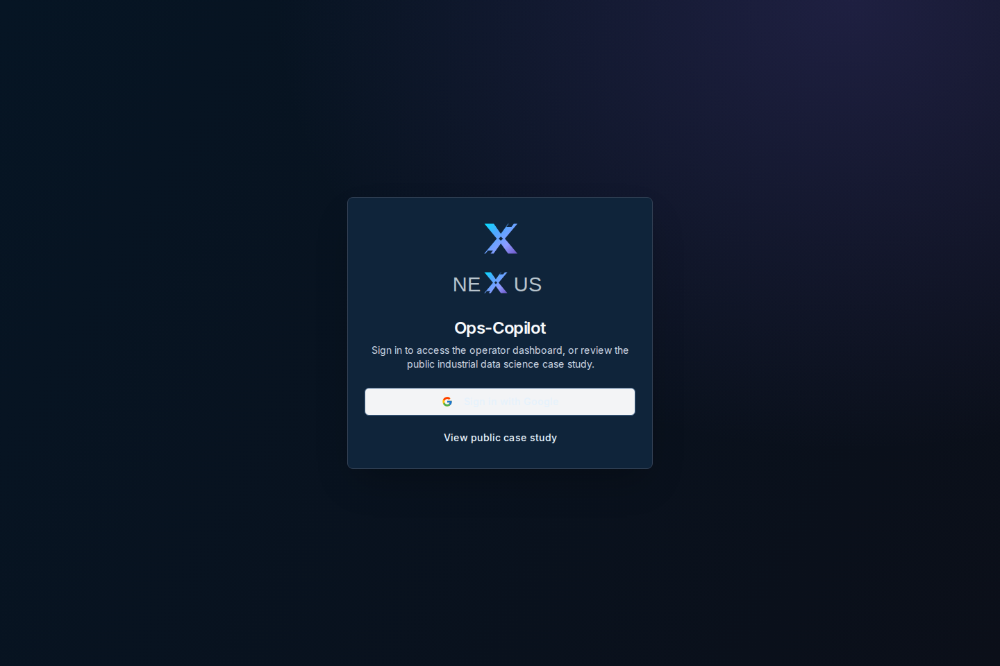
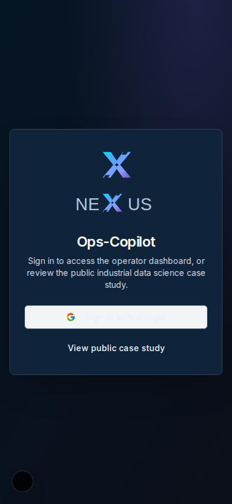
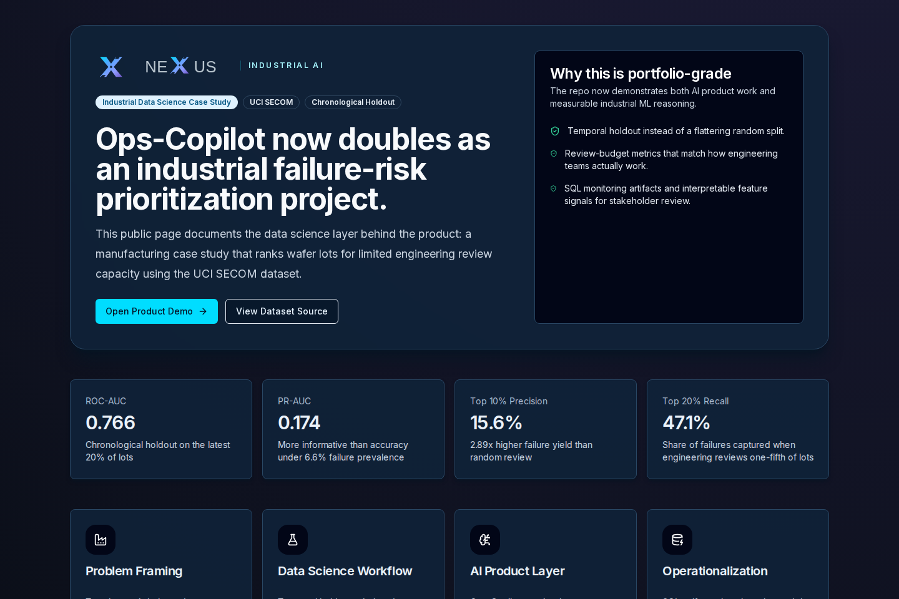
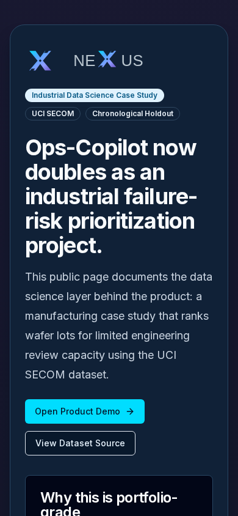

# Ops-Copilot — Document-Grounded Industrial AI Assistant

<p align="right"></p>

**Next.js · Firebase · Genkit/Gemini · Document retrieval · Operator checklists · SECOM ML case study**

Ops-Copilot is an industrial AI assistant for factory operators who need fast, document-grounded troubleshooting support on the production floor. It now also includes a public industrial data science case study built on the UCI SECOM manufacturing dataset, so the repository demonstrates both product engineering and applied ML reasoning.



<sub>Actual local browser capture of the **public sign-in** page, not an authenticated operator session. Dashboard access remains protected by Firebase.</sub>

<details><summary>Mobile public sign-in · 390 × 844</summary>



</details>

Portfolio case study: [senanur-cetin.vercel.app/projects/ops-copilot](https://senanur-cetin.vercel.app/projects/ops-copilot)

In-app case study route: `/case-study` after running the app locally

Earlier, pre-NEXUS case-study walkthrough (archival): [`docs/assets/ops-copilot-case-study.webm`](docs/assets/ops-copilot-case-study.webm)



<details><summary>Mobile SECOM case study · 390 × 844</summary>



</details>

GitHub case-study brief: [`docs/case-study.md`](docs/case-study.md)

Engineering evidence: [`docs/case-study.md`](docs/case-study.md)

## Why this project exists

Industrial troubleshooting often breaks down when operators must search scattered PDFs, tribal knowledge, or maintenance notes under time pressure. Ops-Copilot demonstrates a lightweight way to centralize that knowledge and turn it into a practical assistant with context, auditability, and repeatable workflows.

## What it does

- Answers operator questions with document-grounded responses.
- Uses retrieval-augmented generation over a per-user Firestore-backed knowledge base.
- Supports Firebase authentication, secure server sessions, and persistent operator chat history.
- Highlights the most relevant manual section behind each answer.
- Converts procedural answers into interactive checklists and stores progress logs for later review.
- Includes a reproducible manufacturing failure-risk case study with Python analysis, model artifacts, and SQL monitoring queries.

## GitHub Actions REST API integration

Ops-Copilot also includes a standalone, **read-only GitHub API integration** for diagnosing CI workflow usage. It retrieves workflow runs and job timings, ranks time-consuming workflows and suggests optimization candidates without making changes or using Actions runner minutes locally.

```bash
node scripts/github-actions-audit.mjs senanurcetin/Ops-Copilot --limit 20
node --test tests/github-actions-audit.test.mjs
```

It supports private repositories with an optional read-only `GH_TOKEN`. Select an inclusive UTC time window with `--since 2026-10-01 --until 2026-10-12`, including for multi-repository comparisons. Both boundaries are validated before any API request.

For a **read-only, side-by-side sample comparison** of two repositories, use:

```bash
node scripts/github-actions-compare.mjs senanurcetin/Ops-Copilot senanurcetin/ot-sentinel --since 2026-10-01 --limit 10 --markdown
```

This compares recent run/job counts and observed elapsed job-minutes, not billed Actions minutes or normalized engineering performance. Add `--since YYYY-MM-DD` to select recent runs, or `--markdown` to produce a review-ready report without using a GitHub Actions runner. Reported elapsed job-minutes are **not billed minutes**.
The auditor distinguishes workflows by stable GitHub workflow IDs even when several files share the same display name, avoiding misleading aggregate statistics. When the REST API provides `total_count`, reports also distinguish all **matching runs** from the smaller **inspected sample**, so missing older results are visible. New `--event schedule` and `--status failure` filters use GitHub's own REST API query parameters to focus on specific triggers and outcomes **before** sampling. These can be combined with date-window and branch filters. It also supports `--branch main` (or a feature branch) to analyze only workflow runs associated with the selected branch.

**Verified multi-repository example:** [two public GitHub Actions repositories, job timestamps and comparison limits](docs/github-actions-repository-comparison-example.md).

**Review the working GitHub API integration:** [reproducible demo with real public API evidence](docs/github-api-live-demo.md) · [Developer Program application details](docs/github-developer-program-application.md). See the [integration guide, API endpoints, privacy limits and support contact](docs/github-actions-integration.md).

## Public interactive GitHub Actions Explorer

A [public, interactive Actions explorer](/developer-tools/github-actions) lives at the route `/developer-tools/github-actions` when Ops-Copilot is running. It reads up to 10 recent runs through a bounded, cached server-side API endpoint; users can enter a public `owner/repo` and inspect linked workflow records, success/failure counts and sampling limitations. No private GitHub token, GitHub App installation, paid Actions runner or login is required for this developer demo. The demo route is implemented but has not been publicly deployed or independently checked at a live URL.

## GitHub REST resilience

The read-only CLI now has bounded retry handling for short-lived GitHub API throttling/transient errors and a small, 30-second process-local cache for **anonymous public GET responses only**. Private authenticated responses are never stored in the shared cache. See [reliability and rate-limit details](docs/github-actions-integration.md).

## CLI release management

The GitHub Actions Auditor has a versioned [0.1.0 release candidate changelog](tools/github-actions-auditor/CHANGELOG.md) and a [pre-publication release verification checklist](docs/github-auditor-release-process.md). No package-registry release or new GitHub release has been claimed.

## Standalone developer CLI package

The GitHub Actions REST auditor can also be assembled as a **dependency-free npm-style CLI package**, separate from Next.js/Firebase:

```bash
npm run auditor:package
npm run auditor:pack:dry-run
node --test tests/github-actions-package.test.mjs
```

The builder copies the maintained read-only API modules, README and MIT license into an ignored staging directory. This is a reproducible **release candidate only**; it does not imply a published npm package or Developer Program membership. See [standalone package instructions](tools/github-actions-auditor/README.md).

## Optional GitHub App installation authentication

A [least-privilege GitHub App authentication scaffold](docs/github-app-integration.md) is available for local read-only audits of selected private repositories. The local CLI signs an RS256 JWT from a private key kept outside the repository and exchanges it for an installation token restricted to one repository with `Actions: read`. **No GitHub App has been created or installed automatically.** Registration and private-key provisioning remain the account owner's responsibility.

## Architecture snapshot

- **Frontend:** Next.js App Router, React 19, Tailwind CSS, ShadCN UI
- **AI runtime:** Genkit with Google Gemini 2.5 Flash
- **Knowledge layer:** Per-user Firestore-backed manual store with lexical relevance ranking
- **Auth layer:** Firebase Authentication with secure server-side session cookies
- **Data layer:** Firestore chat history and checklist progress logs
- **Case-study layer:** Python, pandas, scikit-learn, and generated JSON artifacts for the SECOM portfolio analysis
- **Deployment target:** Firebase App Hosting

## Evaluation snapshot

- **Dataset:** SECOM from the UCI Machine Learning Repository
- **Split:** chronological 80/20 holdout
- **ROC-AUC:** `0.7659`
- **PR-AUC:** `0.1745`
- **Top 10% review budget capture:** `29.4%`
- **Failure-yield lift vs random review:** `2.89x`

## Benchmark comparison

- **Naive baseline:** ROC-AUC `0.500`, PR-AUC `0.0541`
- **Published model, class-weighted logistic regression:** ROC-AUC `0.7659`, PR-AUC `0.1745`
- **Random forest benchmark:** ROC-AUC `0.5195`, PR-AUC `0.0688`

The published model remains logistic regression because it is materially stronger than the naive floor while staying more interpretable and more defensible than the tested tree-based alternative on the same chronological holdout.

## What this proves

- You can frame an industrial workflow problem in both product and applied-ML language.
- You can evaluate an imbalanced manufacturing classification problem with decision-support metrics instead of generic accuracy claims.
- You can package that logic into usable software with persistence, security, and recruiter-readable proof surfaces.

## Local setup

### Prerequisites

- Node.js 20+
- npm
- A Firebase project with Authentication and Firestore enabled
- A Google AI Studio API key

### Install

```bash
npm install
cp .env.example .env
```

Update `.env` with your Firebase web configuration and Gemini API key.
For local verified server actions, also provide Firebase Admin credentials via
`GOOGLE_APPLICATION_CREDENTIALS` or the `FIREBASE_*` server variables shown in
`.env.example`.

### Run

```bash
npm run dev
```

The app runs on `http://localhost:9002`.

### Quality checks

```bash
npm run lint
npm run typecheck
npm run test
npm run case-study:refresh
```

## Repository highlights

- `public/knowledge_base.json` contains the sample knowledge corpus.
- `src/ai/flows/*` contains the retrieval and answer-generation workflows.
- `src/server/*` contains verified session and Firebase Admin helpers.
- `src/firebase/*` contains client authentication and Firestore wiring.
- `docs/blueprint.md` captures the product blueprint and implementation intent.
- `analysis/run_secom_case_study.py` rebuilds the industrial data science artifacts.
- `docs/case-study.md` documents the SECOM research methodology and measured results; the README describes the application and navigation.
- `src/data/secom-case-study/*` powers the public case-study page.
- `sql/*` shows review-queue, monitoring, and impact queries for a warehouse implementation.

## Limitations

- The retrieval layer is currently lexical rather than embedding-based.
- The SECOM layer is an offline portfolio case study, not a deployed live model service.

## Scope and operational boundaries

Document-grounded answers and interactive checklists support operator review; they are not validated operating procedures or substitutes for plant safety policies. The SECOM model is an offline benchmarking exercise, not an integrated live equipment-monitoring service.

This repository is documentation-first. It is intended to show product thinking for industrial AI copilots and industrial data science systems rather than act as a polished public SaaS deployment.

## Contributing and security

Contributions to the public GitHub API tooling, documentation, accessibility and offline tests are welcome. See [CONTRIBUTING.md](CONTRIBUTING.md) for local test commands and review guidelines. Report non-sensitive bugs using the GitHub issue forms. Vulnerabilities require private disclosure through [SECURITY.md](SECURITY.md), not public issues.

Developer support: [senanur.cetin.work@gmail.com](mailto:senanur.cetin.work@gmail.com). This is a demonstration project, not a certified industrial safety product.

## License

MIT

## Offline NEXUS tag-map viewer

Open the **NEXUS Tag Map** sidebar link (or visit `/developer-tools/nexus-tag-map`). Choose the reviewed JSON export from Vision2DCS. The browser validates the file (maximum 1 MiB) and displays up to 100 matching tag rows with local filtering. The file is not sent to Firestore, Genkit, server actions or local storage; switching/clearing the file discards the in-memory view. Only local reviewed-concept metadata is displayed: **this is not a verified engineering sign-off, telemetry connection or automatic equipment-control integration**. CI runs size-boundary and no-network regression tests.

## NEXUS read-only interoperability contract

Ops-Copilot includes an offline parser for Vision2DCS's reviewed, read-only Tag Map v1. It validates untrusted JSON but does not yet import or store it, synchronize products or send PLC/DCS commands. See `src/lib/nexus-tag-map.ts` and `tests/nexus-tag-map.test.ts`.


## Firebase two-account isolation acceptance (localhost only)

A security-sensitive workflow requires two separate checks:

- **CI contract check:** `tests/firestore-rules-contract.test.ts` verifies that the committed `firestore.rules` keeps user profile/messages scoped to `request.auth.uid` and does not grant browser access to Admin-only `knowledgeDocuments` or `checklistLogs`.
- **Real Firebase Emulator integration:** `tests/firestore-isolation.emulator.test.ts` creates two **anonymous test users** (Alice/Bob) in **localhost emulators**, proves own-profile/own-message access, rejects cross-user reads and writes, and confirms client access to the Admin-only subcollections is denied. The test does not create or access real Firebase users or data.

To run locally (after installing the usual npm project dependencies and Firebase CLI):

```bash
npx firebase-tools emulators:exec --only auth,firestore --project demo-nexus-ops-isolation "npm run test:firestore:emulator"
```

The checked-in `firebase.json` fixes Auth to `127.0.0.1:9099` and Firestore to `127.0.0.1:8080`, with Emulator UI disabled. The integration test **refuses to run** unless both localhost emulator host environment variables match, and rejects non-demo Firebase project IDs. Use the explicit `demo-` project in the command even if your `.firebaserc` points to a real project. No service account, billed cloud resource, production rule deployment or real user data is required.

**CI:** The existing Node build runs offline rules contract checks, and a separate `firestore-isolation` GitHub Actions job starts real localhost Auth/Firestore emulators with a disposable `demo-` project. A passing emulator job is stronger than source inspection but still does not prove session-cookie browser authentication, server Admin SDK behavior under a real deployment, or production tenant isolation. Those need separate authorized live acceptance. Never run `firebase deploy` as a substitute for local emulator validation.

